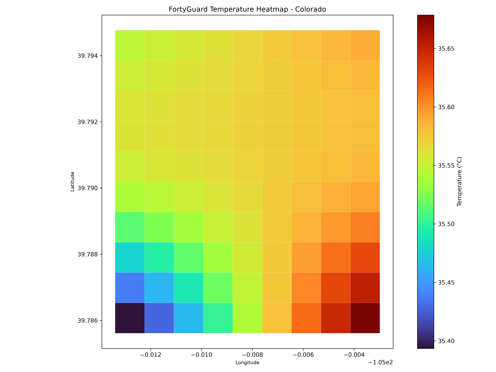
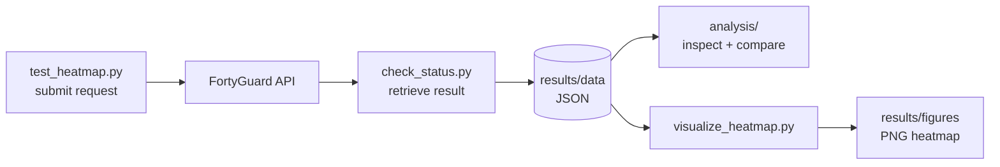

<div align="center">

# FortyGuard Product Evaluation

**A hands-on test of the FortyGuard Temperature API: from request submission to result inspection and visualization.**




</div>

---

## Contents

- [Summary](#summary)
- [How It Works](#how-it-works)
- [What Was Evaluated](#what-was-evaluated)
- [Test Setup](#test-setup)
- [Quick Start](#quick-start)
- [Project Structure](#project-structure)
- [API Notes](#api-notes)
- [Limitations](#limitations)
- [Security](#security)

## Summary

This project evaluates the **FortyGuard Temperature Dashboard and API** as a developer would use it: authenticate, submit an analysis request for an area of interest, retrieve the completed result, inspect the response, and visualize it.

| | |
|---|---|
| **Analytic types tested** | 4 (Temperature Classification Map, Time of Measure, Exceedance, Persistence) |
| **Outcome** | All four were successfully submitted and their completed results retrieved |
| **Output formats handled** | JSON responses, GeoJSON map data, rendered PNG heatmap |

> **Scope:** This evaluation tests product *functionality* (request submission, result retrieval, response structure). It does **not** independently validate temperature accuracy.

## How It Works



## What Was Evaluated

| Analytic | What it examines | Inspect with | Saved result |
|---|---|---|---|
| **Temperature Classification Map (TCM) / Heatmap** | Spatial temperature classification over the area | `analysis/inspect_json.py`, `scripts/visualize_heatmap.py` | `results/data/heatmap_result.json` |
| **Time of Measure** | When measurements occur within the window | `analysis/inspect_time_measure.py`, `analysis/compare_time_results.py` | `results/data/time_of_measure_result.json`, `time_of_measure_result_2.json` |
| **Exceedance** | Where and how much a threshold is exceeded | `analysis/inspect_exceedance.py` | `results/data/exceedance_result.json` |
| **Persistence** | How persistently a threshold is exceeded | `analysis/inspect_persistence.py` | `results/data/persistence_result.json` |

## Test Setup

Requests are built in `scripts/test_heatmap.py`:

| Parameter | Value |
|---|---|
| Area of interest | ~1 km x 1 km polygon in Denver, Colorado (GeoJSON) |
| Date | 2024-07-15 |
| Time window | 14:00 to 16:00 |
| Granularity | 100 |
| Threshold / direction | 30 / above |
| Analytic type | Set via `analytic_type` in the payload (e.g. `"persistence"`) |

## Quick Start

**1. Clone and install**

```powershell
git clone https://github.com/faith-amanze/fortyguard-product-evaluation.git
cd fortyguard-product-evaluation
pip install -r requirements.txt
```

**2. Set your API key** (stored in your session only, never in code)

```powershell
$env:FORTYGUARD_API_KEY = "your-key-here"
```

**3. Run the workflow**

```powershell
python scripts\test_heatmap.py          # submit an analysis request
python scripts\check_status.py          # retrieve the completed result
python analysis\inspect_persistence.py  # inspect a saved result
python scripts\visualize_heatmap.py     # render the heatmap PNG
```

The saved results in `results/data/` are included, so you can run the `analysis/` scripts and `visualize_heatmap.py` **without an API key**.

All file paths are resolved relative to the project root, so scripts work from any directory.

## Project Structure


## API Notes

Details observed while building this evaluation:

- **Endpoint:** `POST https://api.fortyguard.com/v1/heatmap`
- **Authentication:** `api-key` request header
- **Input:** a GeoJSON `FeatureCollection` (`polygon_aoi`), a `date_time` block, `granularity`, and `analytic_type`; threshold-based analytics also take `threshold` and `direction`
- **Output:** JSON; map results are GeoJSON under `data.result.map_data`, which loads directly into GeoPandas for plotting

## Limitations

- Tested on **one area** (Denver) and **one date**; results may not generalize to other locations, seasons or time windows.
- Evaluates **functionality only**. Temperature values were not compared against ground-truth sources.
- Results are a **snapshot**; the API may change after this evaluation.

## Security

The API key is read from the `FORTYGUARD_API_KEY` environment variable. Never commit credentials to this repository.
